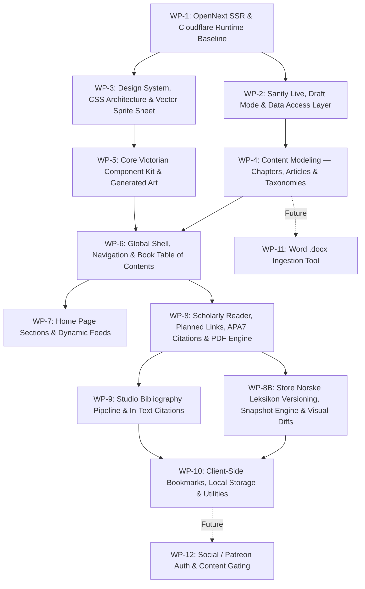

# Engineering Backlog & Scoped Work Packages

This backlog structures the roadmap for **Oliver's Guide To Everything** into prioritized, self-contained work packages. It reflects the architecture decisions finalized with the Product Owner / Tech Lead and adheres to **Sanity Best Practices** (`.agents/skills/sanity-best-practices/`).

---

## Work Package Matrix & Sequencing

---

## Definition of Done (All Work Packages)

Every work package must satisfy the 3-tier verification gate before commit/push:
- **Code / UI / Styles / Sprites:** `npm run check` passes (`tsc --noEmit` + `eslint` across `web` and `studio`, plus Vitest unit and contract tests).
- **Sanity Schemas / GROQ Queries:** `npm run typegen && npm run check` passes (verified by dynamic schema and query sync tests in `web/tests/sanity-schema-sync.test.ts`).
- **Cloudflare / OpenNext / Build / Route Config:** `npm run verify` passes (`npm run check` + full OpenNext Worker build, `wrangler deploy --dry-run`, and live `workerd` HTTP smoke tests).

---

## WP-1: OpenNext SSR, Cloudflare Workers Runtime & Verification Baseline [COMPLETED]
* **Objective:** Establish the hybrid SSR/ISR deployment baseline on Cloudflare Workers using `@opennextjs/cloudflare` and enforce a 3-tier automated testing and pre-push verification pipeline (Decisions 004, 006, 007, 010).
* **Key Motivation:** Enables server-rendered routes and prepares for Draft Mode and webhook revalidation while preventing misconfigured builds or missing Worker bindings from reaching production.
* **Scope:**
  - Complete Next.js 16.4.x + `@opennextjs/cloudflare` + `wrangler.jsonc` baseline (`ASSETS`, `WORKER_SELF_REFERENCE`, `nodejs_compat`, Workers Observability logs & traces).
  - Configure `web/open-next.config.ts` with default `defineCloudflareConfig()` and `config.buildCommand = "npm run build:next"` (preventing build recursion and allowing deploys before KV/D1 provisioning).
  - Guard `initOpenNextCloudflareForDev()` in `web/next.config.ts` for development only.
  - Implement 3-tier verification framework:
    - Tier 1: Static analysis (`tsc` + `eslint` in `web` & `studio`) + OpenNext/Wrangler deployment contract validator (`web/src/lib/deployment-validator.ts`).
    - Tier 2: Vitest unit, component, design-system, and dynamic Sanity schema/TypeGen sync tests (`web/tests/`).
    - Tier 3: Live `workerd` runtime HTTP smoke test & Wrangler dry-run bundle check (`web/scripts/smoke-test-worker.mjs`).
  - Wire `.githooks/pre-push` and root `package.json` verification scripts.
* **Sanity Best Practice Alignment:**
  - Standalone Studio remains decoupled in `studio/`.
  - Next.js build no longer uses `output: "export"`.
* **Acceptance Criteria:**
  - [x] `web` builds cleanly with OpenNext without peer-dependency or recursion errors.
  - [x] `npm run verify` passes all static, unit, contract, dry-run, and live `workerd` HTTP smoke checks.
  - [x] Decision Log updated with documented premises (Decisions 004, 006, 007, 010).

---

## WP-2: Sanity Live, Draft Mode, Edge Cache Bindings & Data Access Layer [COMPLETED]
* **Objective:** Provision Cloudflare KV/D1 edge cache bindings and implement real-time draft preview plus fine-grained on-demand revalidation using `next-sanity` Live Content API.
* **Scope:**
  - **Provision & Bind Cloudflare Edge Cache:**
    - Provision Cloudflare KV namespace (`NEXT_INC_CACHE_KV`) and D1 database (`NEXT_TAG_CACHE_D1`) via Wrangler and add bindings to `web/wrangler.jsonc`.
    - Enable `kvIncrementalCache`, `d1NextTagCache`, `memoryQueue`, and `enableCacheInterception: true` in `web/open-next.config.ts` (validated by `deployment-contract.test.ts`).
    - Configure local secrets in `web/.dev.vars` and production secrets via `wrangler secret put` (`SANITY_API_READ_TOKEN`, `SANITY_REVALIDATE_SECRET`).
  - Create unified Sanity live client: `web/src/sanity/live.ts` using `defineLive`:
    - Setup `sanityFetch` and `<SanityLive />` components.
    - Configure `serverToken` / `browserToken` with environment fallbacks.
  - Add Draft Mode route handler at `web/src/app/api/draft-mode/enable/route.ts` using `defineEnableDraftMode`.
  - Add Draft Mode exit route at `web/src/app/api/draft-mode/disable/route.ts`.
  - Mount `<SanityLive />` and conditional `<VisualEditing />` in `web/src/app/layout.tsx`.
  - Add GROQ webhook endpoint `web/src/app/api/revalidate/route.ts` using `parseBody` from `next-sanity/webhook` to handle instant revalidation on document publish/unpublish.
  - Configure Sanity Presentation Tool in `studio/sanity.config.ts` pointing at front-end preview URL.
  - Add unit and smoke tests covering `/api/revalidate` signature verification and draft-mode routes.
* **Sanity Best Practice Alignment:**
  - Strict data isolation: tokens never leaked into client bundles or `wrangler.jsonc` `vars`.
  - Use `stegaClean` for string fields controlling display logic; enforce `stega: false` for all metadata queries and `generateStaticParams`.
  - Always use `defineQuery` for all GROQ queries to guarantee TypeGen schema typing.
* **Acceptance Criteria:**
  - [x] Editing in Sanity Studio updates the preview iframe in real time.
  - [x] Publishing a document triggers the webhook and invalidates the D1/KV tag cache instantly.
  - [x] Public visitors receive pre-rendered cached pages without server overhead (`enableCacheInterception: true`).
  - [x] `npm run verify` passes with KV and D1 bindings active.

---

## WP-3: Design System, CSS Architecture & Vector Sprite Sheet [COMPLETED]
* **Objective:** Replace Tailwind CSS with a structured, modular Vanilla CSS architecture that enforces the Victorian copperplate etching aesthetic.
* **Scope:**
  - Remove Tailwind dependencies (`@tailwindcss/postcss`, `tailwindcss`, PostCSS config).
  - Establish CSS `@layer` hierarchy: `reset`, `tokens`, `base`, `components`, `utilities`.
  - Create `web/src/styles/tokens.css`:
    - Full antique parchment and ink color scale (`--parchment`, `--parchment-light`, `--ink`, `--sepia-mid`, etc.).
    - Typography tokens (Cormorant Garamond scale, line-heights, tracking).
    - Ornate border variables, drop-shadows, and layout geometry (`--paper-max-width: 1180px`).
  - Create `web/src/styles/base.css`:
    - Centered paper sheet floating over a warm dark desk canvas (`#23201c` / `#2e2a25`).
    - Subtle paper texture, drop-shadows, and double-line engraved outer bevels.
    - Responsive mobile layout collapses desk margin to 0 for edge-to-edge reading.
  - Create master SVG sprite sheet `web/public/sprites.svg`:
    - Victorian ornaments, corner flourishes, four-point stars (`✦`), diamond indicators (`◆`), cartouches, arrows, and emblems.
    - Vector `<symbol>` definitions with `currentColor` inheritance for zero-flicker cached rendering.
    - Reusable `<Icon />` component in `web/src/components/ui/Icon.tsx`.
  - Implement 5-variant CSS selector rotation (`:nth-child(5n + x)`) for subtle natural variance in dividers, bullets, arrows, and cards.
* **Acceptance Criteria:**
  - [x] Clean separation: zero Tailwind in build.
  - [x] All icons and flourishes load from a single cached `/sprites.svg` request.
  - [x] Visual layout renders as a centered parchment sheet over a warm desk background (collapsing to edge-to-edge on mobile).

---

## WP-4: Content Modeling — Chapters, Articles & Taxonomies [COMPLETED]
* **Objective:** Restructure Sanity schemas to model the publication as a scientific book with ordered chapters, out-of-order article publishing, and topic filtering.
* **Scope:**
  - **New Document Type:** `chapter` (`studio/schemaTypes/chapter.ts`):
    - `title` (string, required)
    - `number` (number, required, sorted order)
    - `slug` (slug, source: `title`, required)
    - `summary` (text, 2-3 lines)
    - `vignette` (image with hotspot/crop, etching art)
  - **New Document Type:** `topic` (`studio/schemaTypes/topic.ts`):
    - `name` (string, required)
    - `symbol` (string, 2-letter elemental abbreviation, e.g., `[ Ca ]`, `[ Pr ]`)
    - `slug` (slug, required)
    - `description` (string)
  - **Refactor Document Type:** `article` (`studio/schemaTypes/article.ts`):
    - `contentType`: string list (`article`, `guide`, `protocol`, `research-note`).
    - `chapter`: reference to `chapter` (`type: 'reference', to: [{ type: 'chapter' }]`).
    - `chapterOrder`: number (ordering within chapter).
    - `topics`: array of references to `topic` (`of: [defineArrayMember({ type: 'reference', to: [{ type: 'topic' }] })]`).
    - `featured`: boolean (for landing page showcase).
    - `coverEtching`: image with hotspot & caption.
    - `downloadablePdfs`: array of file objects with title, description, and file asset.
    - `body`: Portable Text with custom block types (figure callouts, annotated terms, formula/reagents).
  - **Refactor Singleton:** `homePage` (`studio/schemaTypes/homePage.ts`):
    - Add references to featured articles, media channels (YouTube, TikTok, LinkedIn), and motto banner copy.
  - **Studio Structure Customization (`studio/src/structure.ts`):**
    - Group by: `Home Page (Singleton)`, `Divider`, `Chapters & Content`, `Topics / Taxonomies`, `Divider`, `Bibliography`.
  - Run `sanity typegen generate` to sync TypeScript definitions into `web/sanity.types.ts`.
* **Sanity Best Practice Alignment:**
  - Schema defines **what content is**, not how it is styled (`references/schema.md`).
  - Use `defineType`, `defineField`, and `defineArrayMember` strictly.
  - Let Sanity generate document `_id`s; enforce singletons purely via Studio structure (`references/studio-structure.md`).
  - No direct video files stored in Sanity assets; links/embeds only.
* **Acceptance Criteria:**
  - [x] Studio displays intuitive navigation with singletons at the top.
  - [x] Articles can be organized under chapters and tagged with elemental topics.
  - [x] Generated TypeScript types accurately reflect all schema changes without manual casting.

---

## WP-5: Core Victorian Component Kit & Generated Art [COMPLETED]
* **Objective:** Build reusable React components with scoped CSS Modules and produce initial copperplate-etched illustrations.
* **Scope:**
  - **Component Library (`web/src/components/ui/`):**
    - `EtchedFrame`: Box container with ornate engraved borders and corner flourishes.
    - `StarDivider`: Horizontal engraved rule with centered 4-point star `✦` or diamond `◆`.
    - `ElementalPill`: Periodic-table category badge (`[ CA ]`, `[ TE ]`) with hover states.
    - `CopperplateButton`: Ornate action button with engraved arrow (`Read Article →`).
    - `EtchedFigure`: Image container with antique caption cartouche and leader lines.
  - **Art Generation Asset Pipeline:**
    - Generate Victorian copperplate etching assets for:
      - Chapter banners (Microscopy, Alchemy/Reagents, Biological Specimens, Lab Apparatus).
      - Media vignettes (Vintage Projector for YouTube, Pocket Lens/Specimen for TikTok, Leather Folio for LinkedIn).
      - Eye insignia and Oliver's Cartouche Logo.
    - Store SVG/PNG assets in `web/public/art/` or upload to Sanity as default vignettes.
* **Acceptance Criteria:**
  - [x] Reusable components styled via CSS Modules without CSS leaks.
  - [x] High-res etching art assets ready and integrated into components.

---

## WP-6: Global Shell, Navigation & Book Table of Contents [COMPLETED]
* **Objective:** Build the global navigation header, elemental quick-filter pill row, and the book-style Master Table of Contents.
* **Scope:**
  - **Global Header (`web/src/components/GlobalHeader.tsx`):**
    - Engraved oval cartouche logo ("Oliver's Guide to Everything").
    - Search input field with attached scope filter.
    - Utility icons: Home (`⌂`), Bookmarks (`🔖`), Settings (`⚙`).
    - Elemental topic pill row (`[ CA ] [ TE ] [ GO ] [ RI ] [ ES ]...`).
  - **Book Index / Table of Contents Page (`web/src/app/contents/page.tsx` or overlay):**
    - Shows all chapters in numbered sequence with Roman numerals and vignettes.
    - Displays published articles nested under their respective chapters.
    - Smooth navigation to article slugs.
    - Standalone treatises section in Appendix.
    - Full search query, scope dropdown, and topic filter support.
  - Update `SiteFooter` with full Victorian rule and responsive navigation links (Register, Table of Contents, Contact, QnA, About).
* **Acceptance Criteria:**
  - [x] Responsive header adapts gracefully to mobile screens with collapsible drawer.
  - [x] Clicking an elemental pill filters articles by that topic on Home and Contents.
  - [x] Book chapters display their nested pages clearly in order.
  - [x] All 3 verification tiers (`npm run check` and `npm run verify`) pass.

---

## WP-7: Home Page Sections & Dynamic Feeds [COMPLETED]
* **Objective:** Assemble the complete Victorian newspaper/journal landing page based on client mockups.
* **Scope:**
  - **Dual Hero Feature Grid:** Two ornate engraved cards showcasing the latest guide and featured protocol.
  - **Popular Categories Carousel / Grid:** Tarot-style portrait cards with circular engraved vignettes.
  - **Mid-Page Decorative Motto Banner:** Full-width etched landscape banner with *"Knowledge for a More Curious World"*.
  - **Popular Media Section:** Vintage etched cards linking to Oliver's YouTube, TikTok, and LinkedIn presence.
  - **"New & Recent" Chronicle Feed:** Compact row feed with etched thumbnails, elemental tags, and publication dates.
* **Sanity Best Practice Alignment:**
  - Data fetched via a single optimized GROQ query using `defineQuery` with field projections.
  - Image URLs built via `@sanity/image-url` specifying exact dimensions, modern WebP/AVIF formats, and automatic quality.
* **Acceptance Criteria:**
  - [x] Matches the aesthetic feel of the high-fidelity mockups in `.files/`.
  - [x] All homepage sections are manageable through the `homePage` singleton document in Sanity Studio.

---

## WP-8: Scholarly 3-Column Reader, Planned Links, APA7 Citations & Paged-Media PDF
* **Objective:** Implement the three-column scholarly journal reading layout, dynamic anchor Table of Contents, resilient internal and planned links, visitor-facing APA7/BibTeX citation generator, Dublin Core metadata, and Paged-Media PDF export engine (Decision 015).
* **Scope:**
  - **Left Column:** Sticky collapsible Table of Contents with active heading observer (H2/H3), anchor sanitization with `stegaClean`, and faint copperplate margin watermark.
  - **Center Column (Main Reader):**
    - Drop caps on opening paragraphs (`.drop-cap`).
    - Justified body text with hyphenation controls.
    - Custom Portable Text serializers:
      - Section headings with stable sanitized `id` anchors for the TOC.
      - Scientific figures (`figureCallout`), reagent boxes (`formulaReagents`), and pull-quotes.
      - Annotated scientific terms (`annotatedTerm`).
      - Rich `internalLink` mark component: dynamically links to resolved articles, chapters, and topics via GROQ, or renders Victorian "In prep" flourishes (`Centrifugation✦`) and tooltip for planned treatises without broken links or 404s.
    - Reader footer: "Last updated" timestamp, author attribution, and anchor slot for Store Norske Leksikon version history and references.
  - **Right Column (Scholarly Utilities & Media):**
    - **APA7 / BibTeX Citation Generator & Modal:** `[ 📜 Cite Protocol ]` generating copyable APA 7th Edition citation and BibTeX record targeting the persistent edition URL (`/[slug]/v{N}/`).
    - **Downloadable PDFs widget:** Direct download links for curated Sanity file attachments (`[ 📄 Protocol Summary • 2.4 MB 📥 ]`).
    - **Paged-Media PDF Engine:** `[ ⎙ Save / Export PDF ]` button invoking the Victorian `@media print` CSS engine with `<PrintHeader>` and `<PrintFooter>` blocks injecting print date, version number, canonical URL, and A4 running folios.
    - Sticky floating figure annotations.
  - **Selected Images Gallery:** Multi-column grid of scientific illustrations with engraved borders and captions.
  - **Metadata Engine:** Dublin Core (`DC.*`) and Google Scholar (`citation_*`) metadata injection via Next.js `generateMetadata` on `/[slug]`.
* **Sanity Best Practice Alignment:**
  - Custom Portable Text components pass props safely and preserve `_key` values for click-to-edit.
  - Heading slugs sanitized with `stegaClean` so DOM IDs match Table of Contents anchor links in draft mode.
  - Schema extension: Add `internalLink` mark annotation to `article.body` with dual-mode support (`resolved` reference vs `planned` title).
* **Acceptance Criteria:**
  - Table of Contents automatically tracks scroll position.
  - Internal links resolve reliably without breaking on slug changes; planned links display informative hover states.
  - Visitors can copy a valid APA7 citation and BibTeX record citing the article's edition.
  - Printing or saving to PDF produces a clean, paginated scientific document with print timestamp, version number, and no web UI clutter.
  - Dublin Core and Google Scholar meta tags render in page `<head>`.
  - PDFs are downloadable directly from Sanity asset storage.
  - Typography renders with the elegance of an antique medical journal.

---

## WP-8B: Protocol Versioning History, Snapshot Engine & Visual Diffs (Store Norske Leksikon Model)
* **Objective:** Implement full editorial version control, Content Lake snapshot archival, persistent immutable routing (`/[slug]/v{N}/`), and an interactive visual diff viewer based on the Store Norske Leksikon reference model (Decision 015).
* **Scope:**
  - **Sanity Content Model for Versioning:**
    - New Document Type `articleVersion` (`studio/schemaTypes/articleVersion.ts`):
      - `article`: reference to parent `article`.
      - `versionNumber`: integer (`1, 2, 3...`).
      - `publishedAt`: datetime (immutable timestamp of this edition).
      - `changeSummary`: string (e.g. *"Adjusted annealing temperature; added control step"*).
      - `snapshotTitle`, `snapshotContentType`, `snapshotBody` (frozen Portable Text data).
    - Refactor `article` schema (`studio/schemaTypes/article.ts`):
      - Version control fieldset: `versionNumber` (integer), `isNewEdition` (boolean), `versionChangelog` (text).
      - Typo fixes, minor formatting, and link tweaks update in-place without bumping `versionNumber`.
      - Toggling `isNewEdition: true` increments the version number and records a new `articleVersion` snapshot.
  - **Routes & Immutable Archival Pages:**
    - Historical edition route: `/[slug]/v[version]/page.tsx` (e.g., `/crispr-knockout/v1/`).
    - Archival alert banner on historical versions: *"You are viewing an archival edition (Version 1) of this protocol recorded on [Date]. [Return to current live edition →]"*.
    - Edge Caching: Cloudflare Workers serves historical editions with `Cache-Control: public, max-age=31536000, immutable`.
  - **Version History & Visual Diff Viewer (`/[slug]/versions/` or footer drawer):**
    - Timeline listing all historical editions with dates, authors, and changelog notes.
    - Interactive text diff viewer comparing two editions, rendering additions and deletions in copperplate ink and parchment tones.
* **Sanity Best Practice Alignment:**
  - Immutable historical documents are first-class Sanity documents queryable via standard GROQ CDN, avoiding native History API rate limits and 30-day retention pruning.
* **Acceptance Criteria:**
  - Oliver can make minor typo edits without triggering version increments.
  - Publishing a new edition creates a permanent snapshot and increments the version.
  - Historical permalinks (`/[slug]/v1/`) render the frozen snapshot reliably with immutable edge caching.
  - The visual diff view highlights changes between protocol editions clearly.

---

## WP-9: Studio Bibliography Pipeline & Render-Time Citations
* **Objective:** Provide a fast workflow for Oliver's EndNote-exported BibTeX files, and render linked APA citations in articles.
* **Scope:**
  - **Sanity Schema for Citations (`studio/schemaTypes/citation.ts`):**
    - `citeKey` (string, e.g. `Smith2020`)
    - `authors` (array of strings)
    - `year` (number)
    - `title` (string)
    - `journal` (string)
    - `doi` / `url` (string)
    - `formattedApa` (string / html, pre-formatted via `citation-js`)
    - `lookupKeys` (array of strings, e.g. `["Smith 2020", "Smith et al. 2020"]`)
  - **Studio Bibliography Tool (`studio/src/tools/bibliography/`):**
    - Studio dashboard tool to drop an EndNote `.bib` file.
    - Parses entries with `citation-js`, calculates lookup keys, and upserts `citation` documents into Sanity via Sanity client mutations.
  - **Server-Side Citation Transform:**
    - During server rendering of the article body, scan text blocks for APA citation patterns (e.g. `(Smith et al., 2020)` or `Smith (2020)`).
    - Match normalized author-year keys against the article's bibliography store.
    - Inject interactive superscript or inline anchor links jumping to the `#references` section.
    - Render an alphabetical, formatted APA `References` list at the foot of the article.
  - **Studio Validation Inspector:**
    - Warning badge in the article editor if an in-text citation cannot be found in the current bibliography dataset.
* **Sanity Best Practice Alignment:**
  - Structured data in Content Lake rather than opaque binary blobs.
  - References normalized once on ingestion; rendering pipeline is pure read-only lookups.
* **Acceptance Criteria:**
  - Oliver uploads a `.bib` file in Sanity Studio; citations become available immediately.
  - In-text APA citations automatically link to the alphabetical reference list at the bottom of the article.
  - Unmatched citations are flagged to the author in the Studio.

---

## WP-10: Client-Side Bookmarks, Local Storage & Utilities
* **Objective:** Provide personal saving/bookmarking of guides and protocols without requiring a backend user account.
* **Scope:**
  - Top navigation ribbon icon (`[ 🔖 ]`) opens a slide-over panel of saved articles.
  - "Bookmark this Guide" button on article headers and card rows.
  - Bookmarks stored in browser `localStorage`.
  - Export bookmarks list as Markdown / JSON for Oliver's personal archival.
* **Acceptance Criteria:**
  - Bookmarks persist across sessions and page reloads.
  - No user accounts, database tables, or cookies required.

---

## Future / Parked Packages
- **WP-11 (Exploratory): `.docx` Word Document Ingestion Tool:** Sanity Studio tool to upload Word `.docx` files, converting headings and text to Portable Text and uploading embedded images directly to Sanity media assets.
- **WP-12: Social / Patreon Auth & Content Gating:** OAuth integration with Patreon / social identity providers to gate select premium protocols or high-resolution PDF downloads.
