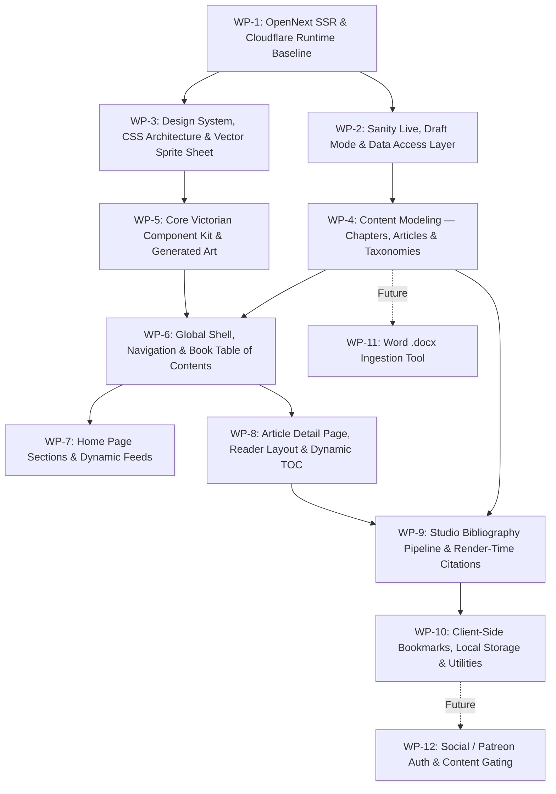

# Engineering Backlog & Scoped Work Packages

This backlog structures the roadmap for **Oliver's Guide To Everything** into prioritized, self-contained work packages. It reflects the architecture decisions finalized with the Product Owner / Tech Lead and adheres to **Sanity Best Practices** (`.agents/skills/sanity-best-practices/`).

---

## Work Package Matrix & Sequencing

---

## WP-1: OpenNext SSR & Cloudflare Workers Runtime Baseline [COMPLETED]
* **Objective:** Establish the hybrid SSR/ISR deployment baseline on Cloudflare Workers using `@opennextjs/cloudflare` (revising Decisions 004, 006, and 007).
* **Key Motivation:** Enables instant on-demand cache revalidation via Sanity webhooks, live Draft Mode preview in Studio, and dynamic route rendering while keeping edge response times under the Cloudflare Free Tier 10 ms CPU budget.
* **Scope:**
  - Complete Next.js 16.4.x + `@opennextjs/cloudflare` + `wrangler` config.
  - Finalize `web/open-next.config.ts`:
    - Incremental cache backed by Cloudflare KV (`kvIncrementalCache`).
    - Tag cache backed by Cloudflare D1 (`d1NextTagCache`) for strong consistency.
    - Queue using `memoryQueue` for on-demand revalidation.
    - Enable `enableCacheInterception: true` to bypass the Next.js server for cached routes (saving CPU).
  - Update `web/wrangler.jsonc` with Cloudflare worker bindings (`KV`, `D1`, service self-reference).
  - Verify local dev environment (`npm run dev`) and test build (`npx opennextjs-cloudflare build`).
  - Update `DECISIONLOG.md` (Revisions to 004, 006, 007).
* **Sanity Best Practice Alignment:**
  - Standalone Studio remains decoupled in `studio/`.
  - Next.js build no longer uses `output: "export"`.
* **Acceptance Criteria:**
  - [x] `web` builds cleanly with OpenNext without peer-dependency errors.
  - [x] Local dev server starts and renders pages.
  - [x] Decision Log updated with documented premises.

---

## WP-2: Sanity Live, Draft Mode & Data Access Layer
* **Objective:** Implement real-time draft preview and fine-grained on-demand revalidation using `next-sanity` Live Content API.
* **Scope:**
  - Create unified Sanity live client: `web/src/sanity/live.ts` using `defineLive`:
    - Setup `sanityFetch` and `<SanityLive />` components.
    - Configure `serverToken` / `browserToken` with environment fallbacks.
  - Add Draft Mode route handler at `web/src/app/api/draft-mode/enable/route.ts` using `defineEnableDraftMode`.
  - Add Draft Mode exit route at `web/src/app/api/draft-mode/disable/route.ts`.
  - Mount `<SanityLive />` and conditional `<VisualEditing />` in `web/src/app/layout.tsx`.
  - Add GROQ webhook endpoint `web/src/app/api/revalidate/route.ts` using `parseBody` from `next-sanity/webhook` to handle instant revalidation on document publish/unpublish.
  - Configure Sanity Presentation Tool in `studio/sanity.config.ts` pointing at front-end preview URL.
* **Sanity Best Practice Alignment:**
  - Strict data isolation: tokens never leaked into client bundles.
  - Use `stegaClean` for string fields controlling display logic; enforce `stega: false` for all metadata queries and `generateStaticParams`.
  - Always use `defineQuery` for all GROQ queries to guarantee TypeGen schema typing.
* **Acceptance Criteria:**
  - Editing in Sanity Studio updates the preview iframe in real time.
  - Publishing a document triggers the webhook and invalidates the tag cache instantly.
  - Public visitors receive pre-rendered cached pages without server overhead.

---

## WP-3: Design System, CSS Architecture & Vector Sprite Sheet [COMPLETED]
* **Objective:** Replace Tailwind CSS with a structured, modular Vanilla CSS architecture that enforces the Victorian copperplate etching aesthetic.
* **Scope:**
  - Remove Tailwind dependencies (`@tailwindcss/postcss`, `tailwindcss`, PostCSS config).
  - Establish CSS `@layer` hierarchy: `reset`, `tokens`, `base`, `components`, `utilities`.
  - Create `web/src/styles/tokens.css`:
    - Full antique parchment and ink color scale (`--parchment`, `--parchment-light`, `--ink`, `--sepia-mid`, etc.).
    - Typography tokens (Cormorant Garamond scale, line-heights, tracking).
    - Ornate border variables, drop-shadows, and layout geometry (`--paper-max-width: 1180px`).
  - Create `web/src/styles/base.css`:
    - Centered paper sheet floating over a warm dark desk canvas (`#23201c` / `#2e2a25`).
    - Subtle paper texture, drop-shadows, and double-line engraved outer bevels.
    - Responsive mobile layout collapses desk margin to 0 for edge-to-edge reading.
  - Create master SVG sprite sheet `web/public/sprites.svg`:
    - Victorian ornaments, corner flourishes, four-point stars (`✦`), diamond indicators (`◆`), cartouches, arrows, and emblems.
    - Vector `<symbol>` definitions with `currentColor` inheritance for zero-flicker cached rendering.
    - Reusable `<Icon />` component in `web/src/components/ui/Icon.tsx`.
  - Implement 5-variant CSS selector rotation (`:nth-child(5n + x)`) for subtle natural variance in dividers, bullets, arrows, and cards.
* **Acceptance Criteria:**
  - [x] Clean separation: zero Tailwind in build.
  - [x] All icons and flourishes load from a single cached `/sprites.svg` request.
  - [x] Visual layout renders as a centered parchment sheet over a warm desk background (collapsing to edge-to-edge on mobile).

---

## WP-4: Content Modeling — Chapters, Articles & Taxonomies
* **Objective:** Restructure Sanity schemas to model the publication as a scientific book with ordered chapters, out-of-order article publishing, and topic filtering.
* **Scope:**
  - **New Document Type:** `chapter` (`studio/schemaTypes/chapter.ts`):
    - `title` (string, required)
    - `number` (number, required, sorted order)
    - `slug` (slug, source: `title`, required)
    - `summary` (text, 2-3 lines)
    - `vignette` (image with hotspot/crop, etching art)
  - **New Document Type:** `topic` (`studio/schemaTypes/topic.ts`):
    - `name` (string, required)
    - `symbol` (string, 2-letter elemental abbreviation, e.g., `[ Ca ]`, `[ Pr ]`)
    - `slug` (slug, required)
    - `description` (string)
  - **Refactor Document Type:** `article` (`studio/schemaTypes/article.ts`):
    - `contentType`: string list (`article`, `guide`, `protocol`, `research-note`).
    - `chapter`: reference to `chapter` (`type: 'reference', to: [{ type: 'chapter' }]`).
    - `chapterOrder`: number (ordering within chapter).
    - `topics`: array of references to `topic` (`of: [defineArrayMember({ type: 'reference', to: [{ type: 'topic' }] })]`).
    - `featured`: boolean (for landing page showcase).
    - `coverEtching`: image with hotspot & caption.
    - `downloadablePdfs`: array of file objects with title, description, and file asset.
    - `body`: Portable Text with custom block types (figure callouts, annotated terms, formula/reagents).
  - **Refactor Singleton:** `homePage` (`studio/schemaTypes/homePage.ts`):
    - Add references to featured articles, media channels (YouTube, TikTok, LinkedIn), and motto banner copy.
  - **Studio Structure Customization (`studio/src/structure.ts`):**
    - Group by: `Home Page (Singleton)`, `Divider`, `Chapters & Content`, `Topics / Taxonomies`, `Divider`, `Bibliography`.
  - Run `sanity typegen generate` to sync TypeScript definitions into `web/sanity.types.ts`.
* **Sanity Best Practice Alignment:**
  - Schema defines **what content is**, not how it is styled (`references/schema.md`).
  - Use `defineType`, `defineField`, and `defineArrayMember` strictly.
  - Let Sanity generate document `_id`s; enforce singletons purely via Studio structure (`references/studio-structure.md`).
  - No direct video files stored in Sanity assets; links/embeds only.
* **Acceptance Criteria:**
  - Studio displays intuitive navigation with singletons at the top.
  - Articles can be organized under chapters and tagged with elemental topics.
  - Generated TypeScript types accurately reflect all schema changes without manual casting.

---

## WP-5: Core Victorian Component Kit & Generated Art
* **Objective:** Build reusable React components with scoped CSS Modules and produce initial copperplate-etched illustrations.
* **Scope:**
  - **Component Library (`web/src/components/ui/`):**
    - `EtchedFrame`: Box container with ornate engraved borders and corner flourishes.
    - `StarDivider`: Horizontal engraved rule with centered 4-point star `✦` or diamond `◆`.
    - `ElementalPill`: Periodic-table category badge (`[ CA ]`, `[ TE ]`) with hover states.
    - `CopperplateButton`: Ornate action button with engraved arrow (`Read Article →`).
    - `EtchedFigure`: Image container with antique caption cartouche and leader lines.
  - **Art Generation Asset Pipeline:**
    - Generate Victorian copperplate etching assets for:
      - Chapter banners (Microscopy, Alchemy/Reagents, Biological Specimens, Lab Apparatus).
      - Media vignettes (Vintage Projector for YouTube, Pocket Lens/Specimen for TikTok, Leather Folio for LinkedIn).
      - Eye insignia and Oliver's Cartouche Logo.
    - Store SVG/PNG assets in `web/public/art/` or upload to Sanity as default vignettes.
* **Acceptance Criteria:**
  - Reusable components styled via CSS Modules without CSS leaks.
  - High-res etching art assets ready and integrated into components.

---

## WP-6: Global Shell, Navigation & Book Table of Contents
* **Objective:** Build the global navigation header, elemental quick-filter pill row, and the book-style Master Table of Contents.
* **Scope:**
  - **Global Header (`web/src/components/GlobalHeader.tsx`):**
    - Engraved oval cartouche logo ("Oliver's Guide to Everything").
    - Search input field with attached scope filter.
    - Utility icons: Home (`⌂`), Bookmarks (`🔖`), Settings (`⚙`).
    - Elemental topic pill row (`[ CA ] [ TE ] [ GO ] [ RI ] [ ES ]...`).
  - **Book Index / Table of Contents Page (`web/src/app/contents/page.tsx` or overlay):**
    - Shows all chapters in numbered sequence.
    - Displays published articles nested under their respective chapters.
    - Smooth navigation to article slugs.
  - Update `SiteFooter` with full Victorian rule and responsive navigation links.
* **Acceptance Criteria:**
  - Responsive header adapts gracefully to mobile screens with collapsible drawer.
  - Clicking an elemental pill filters articles by that topic.
  - Book chapters display their nested pages clearly in order.

---

## WP-7: Home Page Sections & Dynamic Feeds
* **Objective:** Assemble the complete Victorian newspaper/journal landing page based on client mockups.
* **Scope:**
  - **Dual Hero Feature Grid:** Two ornate engraved cards showcasing the latest guide and featured protocol.
  - **Popular Categories Carousel / Grid:** Tarot-style portrait cards with circular engraved vignettes.
  - **Mid-Page Decorative Motto Banner:** Full-width etched landscape banner with *"Knowledge for a More Curious World"*.
  - **Popular Media Section:** Vintage etched cards linking to Oliver's YouTube, TikTok, and LinkedIn presence.
  - **"New & Recent" Chronicle Feed:** Compact row feed with etched thumbnails, elemental tags, and publication dates.
* **Sanity Best Practice Alignment:**
  - Data fetched via a single optimized GROQ query using `defineQuery` with field projections.
  - Image URLs built via `@sanity/image-url` specifying exact dimensions, modern WebP/AVIF formats, and automatic quality.
* **Acceptance Criteria:**
  - Matches the aesthetic feel of the high-fidelity mockups in `.files/`.
  - All homepage sections are manageable through the `homePage` singleton document in Sanity Studio.

---

## WP-8: Article Detail Page, Reader Layout & Dynamic TOC
* **Objective:** Implement the three-column scholarly journal reading layout.
* **Scope:**
  - **Left Column:** Sticky collapsible Table of Contents with active heading observer and faint copperplate margin watermark.
  - **Center Column:** Main article reader:
    - Drop caps on opening paragraphs (`.drop-cap`).
    - Justified body text with hyphenation controls.
    - Custom Portable Text serializers for section headings (with `id` anchors), pull-quotes, callout boxes, and figures.
  - **Right Column:** Downloadable PDFs widget (`[ 📄 Protocol Summary • 2.4 MB 📥 ]`) and floating figure annotations.
  - **Selected Images Gallery:** Multi-column grid of scientific illustrations with engraved borders and captions.
* **Sanity Best Practice Alignment:**
  - Custom Portable Text components pass props safely and preserve `_key` values for click-to-edit.
  - Heading slugs sanitized with `stegaClean` so DOM IDs match Table of Contents anchor links in draft mode.
* **Acceptance Criteria:**
  - Table of Contents automatically tracks scroll position.
  - PDFs are downloadable directly from Sanity asset storage.
  - Typography renders with the elegance of an antique medical journal.

---

## WP-9: Studio Bibliography Pipeline & Render-Time Citations
* **Objective:** Provide a fast workflow for Oliver's EndNote-exported BibTeX files, and render linked APA citations in articles.
* **Scope:**
  - **Sanity Schema for Citations (`studio/schemaTypes/citation.ts`):**
    - `citeKey` (string, e.g. `Smith2020`)
    - `authors` (array of strings)
    - `year` (number)
    - `title` (string)
    - `journal` (string)
    - `doi` / `url` (string)
    - `formattedApa` (string / html, pre-formatted via `citation-js`)
    - `lookupKeys` (array of strings, e.g. `["Smith 2020", "Smith et al. 2020"]`)
  - **Studio Bibliography Tool (`studio/src/tools/bibliography/`):**
    - Studio dashboard tool to drop an EndNote `.bib` file.
    - Parses entries with `citation-js`, calculates lookup keys, and upserts `citation` documents into Sanity via Sanity client mutations.
  - **Server-Side Citation Transform:**
    - During server rendering of the article body, scan text blocks for APA citation patterns (e.g. `(Smith et al., 2020)` or `Smith (2020)`).
    - Match normalized author-year keys against the article's bibliography store.
    - Inject interactive superscript or inline anchor links jumping to the `#references` section.
    - Render an alphabetical, formatted APA `References` list at the foot of the article.
  - **Studio Validation Inspector:**
    - Warning badge in the article editor if an in-text citation cannot be found in the current bibliography dataset.
* **Sanity Best Practice Alignment:**
  - Structured data in Content Lake rather than opaque binary blobs.
  - References normalized once on ingestion; rendering pipeline is pure read-only lookups.
* **Acceptance Criteria:**
  - Oliver uploads a `.bib` file in Sanity Studio; citations become available immediately.
  - In-text APA citations automatically link to the alphabetical reference list at the bottom of the article.
  - Unmatched citations are flagged to the author in the Studio.

---

## WP-10: Client-Side Bookmarks, Local Storage & Utilities
* **Objective:** Provide personal saving/bookmarking of guides and protocols without requiring a backend user account.
* **Scope:**
  - Top navigation ribbon icon (`[ 🔖 ]`) opens a slide-over panel of saved articles.
  - "Bookmark this Guide" button on article headers and card rows.
  - Bookmarks stored in browser `localStorage`.
  - Export bookmarks list as Markdown / JSON for Oliver's personal archival.
* **Acceptance Criteria:**
  - Bookmarks persist across sessions and page reloads.
  - No user accounts, database tables, or cookies required.

---

## Future / Parked Packages
- **WP-11 (Exploratory): `.docx` Word Document Ingestion Tool:** Sanity Studio tool to upload Word `.docx` files, converting headings and text to Portable Text and uploading embedded images directly to Sanity media assets.
- **WP-12: Social / Patreon Auth & Content Gating:** OAuth integration with Patreon / social identity providers to gate select premium protocols or high-resolution PDF downloads.
